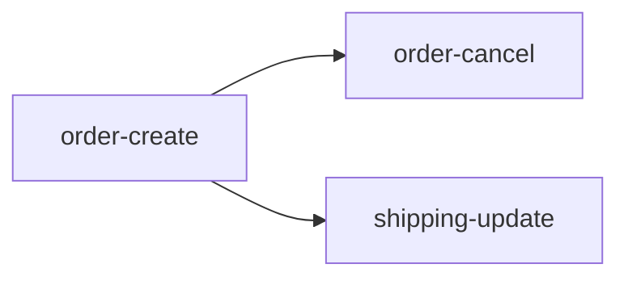

# 피쳐 의존 그래프

> 슬라이스 목록, 상하류, 병렬 가능 묶음. 시각화는 사람용, 상하류 한 줄은 세션 프롬프트(카드)로.

## 슬라이스 목록

| 슬라이스 | 상류 | 하류 | 같은 테이블 쓰는 피쳐 | 병렬 묶음 |
|---|---|---|---|---|
| order-create | - | order-cancel, shipping-update | orders | 1 (레퍼런스 슬라이스, 단독 구현) |
| order-cancel | order-create | - | order-create, shipping-update | 2 |
| shipping-update | order-create | - | order-create, order-cancel | 2 |

## 구현 순서
1. 레퍼런스 슬라이스 1개 단독 구현
2. 의존 없는 슬라이스끼리 병렬 (1인 기준 동시 2~3개 상한)
